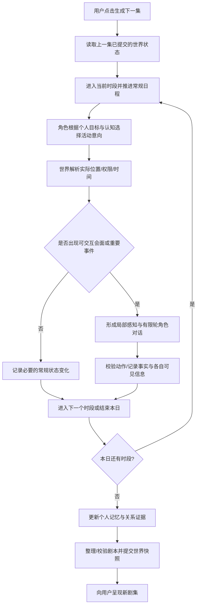

# FriendsVerse — World & Interaction Design

**版本**：v0.1.0（产品机制提案，待原型验证）  
**日期**：2026-10-23  
**阶段**：Story Prototype 设计；未开始编码  
**关联**：[PRD](PRD.md) · [Story Prototype](STORY_PROTOTYPE.md) · [Character Design](CHARACTER_DESIGN.md) · [Decision Log](DECISIONS.md)

> 设计目标：创建一个足以让六个角色自然相遇、主动联系、产生差异性反应和持续关系发展的**轻量共享世界**。原型的成功标准不是地图复杂，而是它能稳定地产生因果可信、有趣且可连续观看的关系故事。

## 1. 设计边界

### 1.1 已确认的上位产品目标
- 观众只观看，不直接扮演、控制或发送指令给角色。
- 轻松搞笑的情景剧剧本；角色关系的长期变化是产品核心。
- 用户**手动**点击下一集才触发新的世界模拟。
- 以六位既有人物为私人粉丝原型；初始关系参考 [Character Design](CHARACTER_DESIGN.md)，不预设未来故事结局。

### 1.2 本文的设计建议（非已锁定技术决策）
- 一集暂对应一个虚拟日，内部只使用「上午 / 下午 / 晚上」三个时段，而不是每小时都调用 Agent。
- 只有四个可多人互动的核心地点，其他工作和住处可用抽象地点表示。
- 采用「活动意向 → 空间/时间解析 → 遭遇 → 有限对话 → 状态提交」的世界循环。
- 普通作息规则化，只有出现有效的社交动机、意外事件或未完成事项时才启用 LLM。
- 环境可提供**机会**，但不会规定角色必须表演哪个戏码。

## 2. 世界的最小地图

| 地点 ID（建议） | 场景 | 用途 | 进入与可见性 |
|---|---|---|---|
| `apt_monica_rachel` | Monica / Rachel 公寓 | 做饭、室友交流、聚会、谈心 | 住户可随时进入；访客需受邀或敲门，未进入前不可听到室内对话 |
| `apt_chandler_joey` | Chandler / Joey 公寓 | 休闲、排练、互相帮忙、私人交流 | 同上 |
| `hallway` | 公共走廊 | 偶遇、拜访、借物、传递信息 | 公共区域；只有同一时段到场的人能直接互动 |
| `central_perk` | 咖啡馆 | 休息、朋友聚集、多人的轻松交流 | 对外开放；只有实际在场的人听得到对话 |
| `offstage_home_ross`, `offstage_home_phoebe` | 抽象住处 | 休息、个人准备 | 不创建多人表演场景，仅记位置/个人日程 |
| `offstage_work` | 其他工作/日常地点 | 工作、试镜、学习、购物等 | 可触发可观察的新事件，但不生成大量额外 NPC |

**简化边界**：不实现街道路网、真实路程、商店经济、完整工作流程；地点之间切换由时段和行动合法性校验。避免把角色误写成从办公室瞬移出现在同时发生的公寓对话中。

**地点需要有不同的社交功能**：公寓更可能触发室友话题，咖啡馆适合熟人偶遇，走廊适合短暂接触；但地点不能强制情节——去咖啡馆不等于必然吵架或谈恋爱。

## 3. 为什么会相遇：角色行动意向与会面解析

### 3.1 每个时段的可用信息
对每个角色，世界提供「当前时段、当前位置、工作/休息约束、自己的近期目标、未兑现的约定、已知邀请、可到达地点」，角色决定是否行动。

**自主行动的四类驱动力**：
1. **日常习惯**：室友早餐、工作后休息、常去咖啡馆；
2. **目标**：Joey 想找人排练；Rachel 想讨论工作选择；
3. **关系**：Chandler 想兑现之前答应 Joey 的帮助；Monica 想关心心情不好的朋友；
4. **生活机会**：错送的快递、停用的咖啡机、临时工作通知等客观刺激。

不能把每个时段固定成「6 人自动进入 Central Perk」。也不应在没有必要时让每人每时段都对 LLM 发起昂贵的完整对话调用。

### 3.2 两阶段处理：避免隐形导演
**阶段 A — 选择意向**：角色只根据自己已知的情况决定去哪里、想做什么、是否找谁、或者继续常规活动。其意向可能失败，比如目标对象不在家。

**阶段 B — 世界解析**：引擎核对活动时段、地点容量/访问权限、是否实际相遇，生成每人可感知的信息。仅真实在同一地点或通过受支持的通信方式才会发生互动。

例子：Joey 准备请 Chandler 排练；但 Chandler 已按先前安排出门工作。Joey 可以等待或以后再约，**世界不能因为剧情需要直接把 Chandler 传送回来**。

### 3.3 主动社交，不只随机偶遇
角色可以因为既有目标/关心/承诺，主动采取「前往对方已知的可能地点」「敲门」「向同地点角色发起对话」。
- 「试图找人」≠「找到人」；
- 「打算帮忙」≠「已经帮过」；
- 「收到邀请」≠「必然接受」。
- 手机、跨场景消息等暂为**P1 可选扩展**；首版可用当面邀请/约定满足必要社交。

### 3.4 防止角色被写成社交机器
角色可以休息、独处、工作、拒绝邀请、提前离开。由于故事发生在六个人之间，不代表每人必须全天互动；安静或错过也可能成为之后的故事背景。

## 4. 时段与完整的一集生成流程

**推荐日内结构**：早晨、下午、晚上共三个主要时段。不等同于每时段每人都必须发言。

- **具体执行顺序**是设计建议，代码阶段再定；核心不变的是角色不可直接写世界事实、对话须在合法会面后发生。
- 多个地点同一时段可以独立推进，但最后更新世界时必须保持一致，避免角色在两个地点同时出现。
- 一次用户点击生成一集，后台**不**继续跑下一集；生成失败保留上一集稳定状态。
- 无足够有效内容时可以交付短集，不能把未发生的事件补写成「精彩剧情」。

## 5. 互动如何开始、进行和结束

### 5.1 一次有效社交包含五步

| 步骤 | 谁决定 | 实例 | 重要约束 |
|---|---|---|---|
| 1. 触发 | 世界/角色共同决定是否有会面机会 | Joey 看见 Chandler 在家 | 没实际见面不能产生对话 |
| 2. 主动 | 角色 | Joey 想问能否帮忙排练 | 不能强制每位在场者讲话 |
| 3. 应答 | 被互动角色 | Chandler 根据安排、心情与关系回应 | 不能按用户预写的剧本回应 |
| 4. 继续/退出 | 双方与世界规则 | 玩笑、约时间或先离开 | 避免无限寒暄、所有人围观 |
| 5. 留痕 | 世界事实 + 私人记忆 | 记录承诺及可见者 | **仅真正的承诺或行动**影响未完事项/关系 |

### 5.2 互动触发优先级（建议，不作为硬编码分数）
- **强触发**：被直接邀请/请求帮助、当前未解决承诺、被对方告知的重要新事实。
- **中触发**：熟悉朋友偶遇、同一任务或兴趣、较明显的情绪/环境变化。
- **弱触发**：普通同地点闲聊、重复寒暄。
- **无触发**：仅经过地点，其他人忙于独立任务且无人主动交流。

允许出现偶然闲聊，但同一种无目标、无变化的寒暄应降频，不应只是为了凑满三到五场戏。

### 5.3 会话结束条件
某个角色离开、问题已解决、无人还有回应意向、时段结束、或达到明确的最大交互轮次/调用预算，都可以结束。
- **建议试验上限**：每次遭遇设置一个小的往返轮次预算（例如上限 4–6 次发言轮换），具体校准后确定；不保证每场都聊满。
- 多人对话不默认每人轮流发言，只有被涉及或想回应的人才参与。
- 终止后若留下约定或误会，应记录为未完成事项，未来有机会自然回访。

## 6. 社交信息与关系结果的形成

### 6.1 事件层与认知层严格分开
以「Chandler 答应帮助 Joey 排练」为例：
- **客观事件**：他在公寓中说过愿意帮忙，记录时间/参与者/原话。
- **Joey 的个人记忆**：听到了答应，可能把它理解为明天的确定约定。
- **Chandler 的个人记忆**：记得答应帮忙，但可能对具体时间理解不同。
- **旁人**：不在场的人不能自动得知此事。

一个角色可以误解、猜测甚至说谎，但只有记录的实际行动与合法观察能成为世界事实。

### 6.2 关系变化规则
- 不能从「Joey 对 Chandler 说了句谢谢」就机械判定 `trust + 5`。
- 重要关系变化需有可引用的 `event_id`、关系方向与语义解释。
- 日常短暂情绪与长期关系分开；两人可以非常亲密但今天有摩擦。
- 高亲密不是免疫冲突，低矛盾也不是强制恋爱。
- 未发现可证实的关系事件时，允许本集无关系变动。

### 6.3 未完事项的持续性
把**明确承诺、重要误会、待回应的邀请、角色当前个人目标**作为「未完事项」保留并有合理机会召回；不需要每集都主动让角色想起所有往事。

**关键原则**：系统可以将 Joey 的旧请求呈现在他的自身记忆里，但不能自动告诉 Chandler「Joey 正在生气」，除非他已经观察到或被告知。

## 7. 防止每天只喝咖啡聊天的机制

这不是靠强行每天制造冲突解决，而是靠不同来源的**自然互动机会**：

| 故事来源 | 示例 | 对角色自主性的影响 |
|---|---|---|
| 日常小摩擦 | 厨房秩序、生活习惯、谁答应帮忙 | 从既有性格/生活目标自然生长 |
| 个人目标 | 试镜、工作变动、音乐表演 | 角色自己选择是否求助/分享 |
| 社交机会 | 邀请晚餐、朋友偶遇、共同休息 | 可以创造会面但不规定结果 |
| 未完事项 | 昨天答应的排练、尚未澄清的误解 | 支持故事回返和关系连续 |
| 外部轻事件 | 错送快递、设施暂坏 | 只添加事实和刺激，不指定争吵/恋爱结局 |

**故事机会控制建议**：一个虚拟日新增 0–1 个主要环境刺激；已有承诺或正在发展的关系线优先于不断投放新事件。该上限是原型参数，尚未实验。

**重要的编辑边界**：模拟进行前可给出生活刺激；剧集整理阶段只剪辑已发生事实。不通过临时改写对白补笑点；也不因为某段对话无趣，就回写人物的情感状态以制造续集。

## 8. 完整的端到端示例（只是可能分支）

前提：EP02 中 Joey 已明确向 Chandler 约明天下午排练，Chandler 有自己的工作安排。EP03 的世界可能出现以下结果（不是预写的正史）：

1. **上午**：Joey 想准备试镜，在个人记忆中看到排练约定；Chandler 仍在工作。
2. **下午**：Joey 在公寓等待；如果 Chandler 的工作占用时间、未回家，乔伊没有机会当面问原因。
3. **晚上**：两人在家中真正相遇；Joey 可以选择询问、抱怨、装作无所谓或谈别的事；Chandler 可以解释、道歉或不合时宜地开玩笑。
4. **事实记录**：保存真实说出的内容、发生地点、已执行的补救行为。
5. **关系与记忆**：如果出现被可靠证据支持的失约、道歉或帮助，才分别更新双方的私人理解和关系；不能强制跌分、强制和解。
6. **观众看到**：剪辑成具有因果顺序的情景剧片段；结尾只展示观众可知的变化。是否成为连续主线，由他们未来实际行为决定。

另一条同样合理的分支：Chandler 提前安排好时间，和 Joey 顺利排练，两人关系没有显著变化，只发生了有趣的笑话。这种结果不能被评测误判为「没有冲突所以失败」。

## 9. 建议的最小产品数据契约

无需此时设计数据库，只需确保可以用最简单的持久化方式表达：

- **`world_state`**：虚拟日与时段、角色实际位置、各地点权限、客观环境状态。
- **`character_state`**：个人目标、短期心情、当前安排、未完事项；稳定 Persona 另存。
- **`intention`**：角色、时段、期望地点/目标、动机、选择依据；不代表成功执行。
- **`encounter`**：真正同处地点的参与者、起止时段、互动发起者与退出原因。
- **`event`**：稳定事件 ID、时间、地点、行动者、接收者、类型、原始对白/动作和可见者。
- **`subjective_memory`**：主体角色、记忆来源事件 ID、个人印象/误解、是否仍未解决。
- **`relationship_change`**：方向 A→B、维度、证据事件、变化原因及前后状态。
- **`episode`**：源事件序列、选中场景、原始对白、前情及发布状态。

**必要但不鼓励过度设计**：时间、地点、source_event_id、可见者、未完事项链接是第一版的基本一致性凭据；无需分布式队列、通用世界本体、复杂图数据库或过度抽象的多 Agent 协议。

## 10. 优先级与验收测试

### P0：原型不可缺少
1. 能推进完整一天的上午/下午/晚上，并保存已执行的行动和世界状态。
2. 角色活动有因果动机；角色可以错过会面，不能被系统强制聚到同一地点。
3. 同地点能自行发起、响应和结束有限轮对话；允许安静、拒绝和退出。
4. 私人知识隔离成立；不在场者不会无故知道聊天内容。
5. 新互动的承诺/矛盾可以成为下一集的自主行为动机。
6. 事件和关系变化可回溯；场景整理不虚构关键动作或对白。
7. 符合单次手动推进、不重复发布、失败可重试的上一阶段要求。

### P1：原型验证后再做
电话/留言、详细通勤、更多社交地点、权重精细化、角色日程偏好学习、关系图高级检索、更多外部 NPC。

### 测试情境（使用同一角色基线，期望多种合理结果）
- **T01 会面错过**：Joey 要找 Chandler 排练，但 Chandler 工作；不能无故在公寓即时相遇。
- **T02 主动约见**：Joey 有目标、Chandler 可见；可以提出请求，对方有权拒绝或约其他时间。
- **T03 群像对话**：四人在咖啡馆；不必四人轮流讲话，对话可自然收束。
- **T04 信息隔离**：两人在公寓秘密交流，外出的第三人不得知道。
- **T05 承诺跨集**：本集约定下一集排练；能记住但不能强迫遵守或违约。
- **T06 普通日**：没有外部事件，依然允许正常生活/短集，不靠伪造冲突满足 3–5 场。
- **T07 同时事件**：同一时段不同地点互动，角色不能同时出现于两个地点。
- **T08 关系证据**：没有真实事件不能无故更改长期信任；有事件时能找到来源。
- **T09 对话终止**：遇到重复寒暄、离开、预算结束时可以安全停止并保存现状。

## 11. 待确认与版本记录

待在技术原型中校准：每时段角色意向生成频率、对话轮次上限、环境刺激频率、在场人数限制、异步互动机制是否需要提前纳入、模拟成本与故事密度的平衡。

| 版本 | 日期 | 变更 |
|---|---|---|
| v0.1.0 | 2026-10-23 | 首次定义小地图、时间推进、社交意向/会面、对话、可见性、未完事项、反流水账策略和最小验收 |
